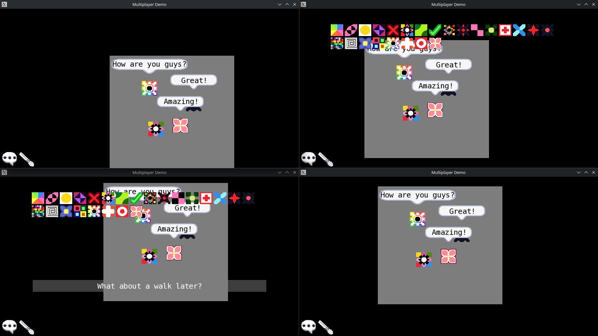

# Multiplayer demo
Simple multiplayer game where you can chat with others. This repository contains both the server and the client applications. It only works in a LAN.



## Building
This project depends on C++17, [CX](https://github.com/Acerx-AMJ/CX-Lib) and [SFML](https://www.sfml-dev.org/). The recommended way to build is using CMake. It will build both the server and the client executables:
```bash
cmake -B build
cmake --build build
```
Server will be located in `build/server` and the client in `build/client`.

## Usage
First run the server:
```
./build/server
Server listening on 192.168.8.50:43996...
```
Server will tell your private IP and on which port it is listening. Open up as many clients as you'd like to and input the IP and port when asked:
```
./build/client
Input server's IP: 192.168.8.50
Input server's port: 43996
Successfully connected to 192.168.8.50:43996 with ID 1.
```
And the server will in turn tell you when someone connects or chats:
```
New sender connected: 1@192.168.8.51:50747.
New TCP socket connected.
Chat message from ID 1: Hello, World!
```

## Credits
This project was made by Daniel Vishnevsky and is licensed under MIT License. It was made in February of 2025 and published in October 2026 as an effort to make all of my projects open-source.
